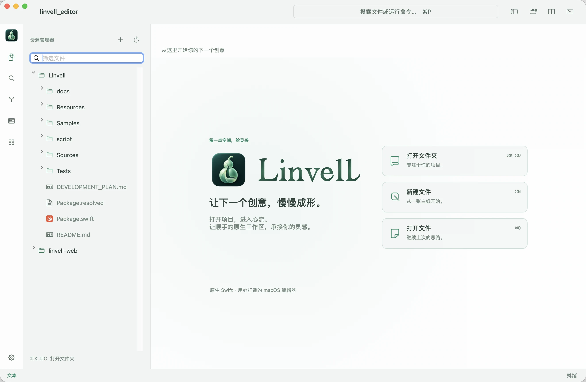

# Linvell

[Official website](https://linvell.fuluwa.top/) · [Download releases](https://github.com/huluxiaohuowa/Linvell/releases)

A native macOS editor built in Swift and AppKit. The workspace follows the familiar activity-bar, explorer, editor-tab and terminal-panel structure, with an independent visual identity and a gourd-inspired icon.

**Under active development.** Full Vim compatibility and the complete development-tool workflow remain in progress. See [development status](docs/STATUS.md).



Actual welcome screen with the built-in Linvell Light theme.

## Install with Homebrew / 通过 Homebrew 安装

```sh
brew install --cask huluxiaohuowa/tap/linvell
```

Requires Homebrew and macOS 15.6 or later. The Linvell-maintained tap provides the signed, notarized Universal app and updates after stable GitHub Releases.

需要先安装 Homebrew，支持 macOS 15.6 及以上。Linvell 自建 tap 提供已签名、公证的 Universal 应用，并随稳定版 GitHub Release 自动更新。

Upgrade / 升级：

```sh
brew update
brew upgrade --cask huluxiaohuowa/tap/linvell
```

Homebrew installations are updated through Homebrew. / 通过 Homebrew 安装的版本请通过 Homebrew 更新。

Official Homebrew Cask inclusion is pending; see [distribution details](docs/CI_RELEASE.md#homebrew-distribution).

## Run locally

Requires macOS 15.6+, Xcode and its command-line tools.

```sh
./script/build_and_run.sh
swift test --scratch-path "$HOME/dev/build/linvell/swiftpm" --cache-path "$HOME/dev/build/linvell/cache" --config-path "$HOME/dev/build/linvell/config" --security-path "$HOME/dev/build/linvell/security"
```

The Codex Run action uses the same script. Build outputs are kept outside the repository under `~/dev/build/linvell`. `--demo` opens the public sample workspace, `--build-only` stages the app without launching, and `--debug` starts LLDB.

## Appearance and preferences

Open **Linvell → Settings** (`⌘,`) for appearance, editor, Vim and iCloud preferences. Built-in themes: Linvell Dark, Nord, Linvell Light and Solarized Light. Default editor text is 15 pt. Sidebar, split editor and terminal panels are resizable.

The **Updates** category provides independent switches for automatic checks, downloads and installation on normal quit. Automatic downloads and installation are off by default. Manual installations check GitHub Releases and require matching checksums and the Linvell signing identity. Homebrew installations check their tap (or the official Homebrew API), show the appropriate upgrade command, and leave installation to Homebrew.

iCloud Drive can synchronize the preference allowlist in `Linvell/Preferences.json`: theme, font, text size, wrapping, line numbers, indentation and Vim mode. Preferences are merged per setting using their modification times. The sync switch and machine-specific layout stay local. Documents, recovery snapshots, project paths, terminal environment and credentials never enter this preference file. iCloud Drive must be available; actual delivery to another Mac is managed by iCloud and needs cross-device verification.

## Plugin development

Linvell 0.2.3 and later include [native plugin installation and management](docs/plugins/management.md), including ZIP/HTTPS/catalog installation, startup restoration, enable/disable, explicit updates, rollback and uninstall/data cleanup. The published application includes this manager.

Linvell 0.2.0 includes the P1–P5 plugin APIs: an independent Swift process SDK, document events, commands/menus/shortcuts, versioned edits, layered configuration/state, native views and resources, LSP/task/DAP programs, logs and SSH workspace execution. Start with [the bilingual plugin guide](https://linvell.fuluwa.top/plugins.html), [`Examples/HelloPlugin`](Examples/HelloPlugin) or [`Examples/ToolPlugin`](Examples/ToolPlugin). Code plugins have the user account’s OS access; manifest permissions gate editor APIs, not a security sandbox. See [P4/P5 verification and limits](docs/verification/plugins-p4-p5.md). The standalone SDK is `Sources/LinvellPluginKit`; Linux builds produce plugin programs, while Linvell remains a macOS app.

## Remote development, running and Git

Linvell 0.2.5 includes [existing agent CLI integration](docs/AGENT_CLI.md) for Codex, OpenCode, Pi, Claude Code and DeepSeek Harness, with concurrent sessions, live provider switching, native terminal resume, in-workspace file/image opening, SSH execution, and local-agent access to SSH projects through an optional existing SSHFS installation. Shared desktop/CLI stores are supported; cloud-only sessions need the provider's handoff. No agent runtime is bundled.

Read the bilingual [usage guide](https://linvell.fuluwa.top/guide.html) for SSH workspaces, local/remote run and web preview, Git Graph, VS Code-style shortcuts and normal/Vim multi-selection editing. Guide source is maintained in [linvell-web](https://github.com/huluxiaohuowa/linvell-web/tree/main/docs).

SSH uses the system configuration and authentication; the remote file protocol needs Python 3. This is a native remote editing and running workflow, without a VS Code extension or debug-adapter host.

Version 0.1.7 adds optional auto-save, semantic navigation/completion/rename, project-local multilingual toolchains, submodule management and extended native Git operation forms/console. See [development status](docs/STATUS.md) for tested behavior and limits. Bilingual instructions are maintained in the sibling `linvell-web` repository as `docs/guide-0.1.7.en.md` and `docs/guide-0.1.7.zh.md`.

## Distribution

Build, sign, notarize and package Universal DMG/ZIP artifacts on the standard **GitHub-hosted macOS runner**, then publish to [GitHub Releases](https://github.com/huluxiaohuowa/Linvell/releases). There is no App Store upload. Public-repository standard runners are used; no paid large runner is selected.

```sh
# Default release: increment patch on CI, build and publish.
gh workflow run release.yml --field bump=patch
# Explicit alternatives:
# gh workflow run release.yml --field bump=minor
# gh workflow run release.yml --field bump=major
```

The workflow uses the repository Actions Secret `APPLE_RELEASE_CONFIG`, containing only the shared Developer ID Application certificate and App Store Connect notarization key. It materializes these outside the checkout, uses a temporary protected keychain, removes the credentials after the run, and uploads only signed distribution artifacts. Pull requests never receive these secrets.

`python3 script/update_version.py` still defaults to a patch increment for manual version preparation; `minor` and `major` remain explicit. Patch/minor carry at 1000: `0.2.9 → 0.2.10`, `0.2.999 → 0.3.0`; explicit minor/major increments reset lower components. Pushing a matching stable `vX.Y.Z` tag also builds the already-committed version. See [CI release details](docs/CI_RELEASE.md). Local debug builds remain available through the Run script.
